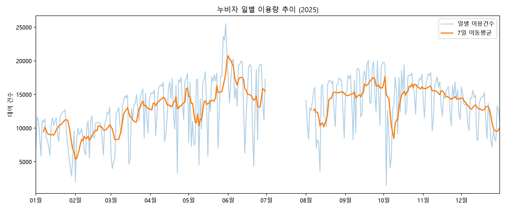
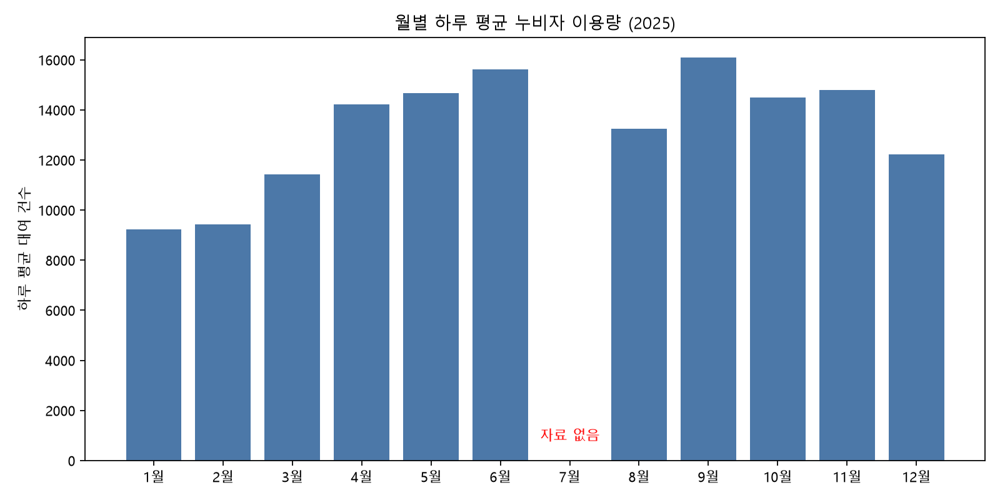
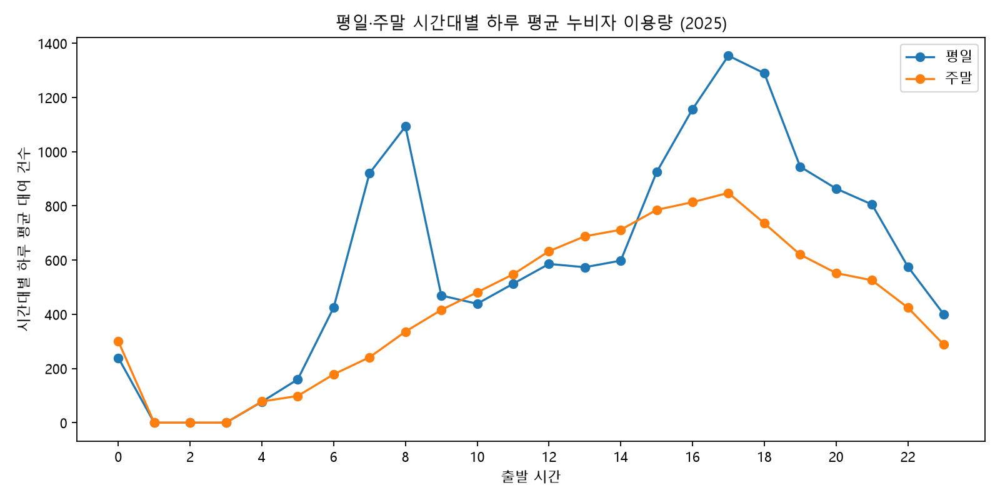
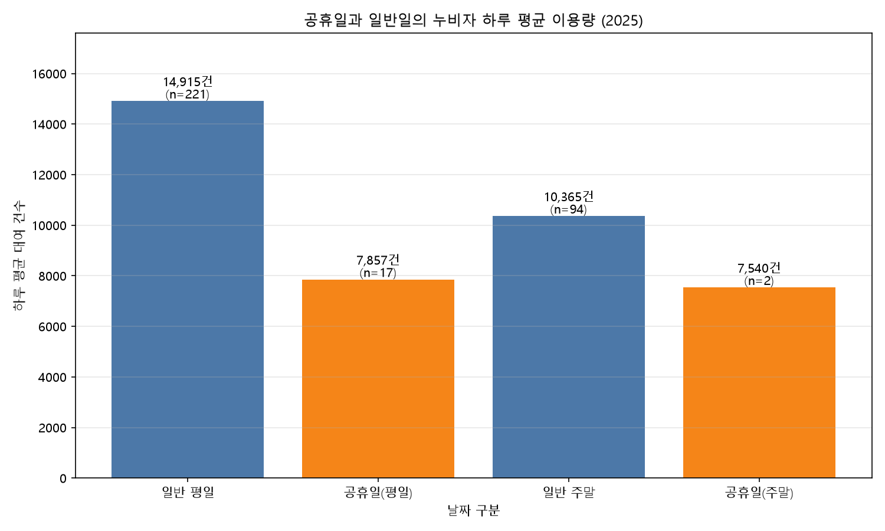
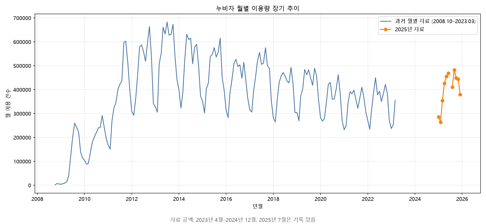

# 누비자 이용 데이터 분석 보고서

## 1. 분석 주제

**창원시 공영자전거 누비자의 이용량은 계절·요일·시간대·공휴일에 따라 어떻게 달라지는가?**

2025년 대여 이력과 2008년 10월부터 2023년 3월까지의 월별 이용현황 자료를 정리해 이용 패턴을 살펴봤다. 이 보고서는 관측된 차이를 설명하며, 원인을 단정하지 않는다.

## 2. 분석 질문

1. 2025년 일별 이용량과 월별 평균은 어떤 흐름을 보이는가?
2. 평일과 주말의 하루 중 시간대별 이용 패턴은 어떻게 다른가?
3. 공휴일 이용량은 일반 평일·주말과 어떻게 다른가?
4. 과거 월별 자료와 비교할 때 장기 이용량은 어떻게 변했는가?

## 3. 데이터와 전처리

| 자료 | 기간 및 규모 | 사용 방법 |
|---|---|---|
| 창원시 누비자 대여·반납 이력 | 2025-01-01~2025-12-31, 4,419,063행 | 출발일과 출발시간으로 대여 건수를 날짜·시간별 집계 |
| 창원시 누비자 월별 이용현황 | 2008-10~2023-03, 174개월 | 월별 장기 추이와 완전한 연도별 합계 비교 |
| 2025년 공휴일 목록 | 2025년 날짜 목록 | 평일·주말 여부와 공휴일 여부를 결합해 날짜 유형 분류 |

대여 이력 CSV는 CP949 인코딩으로 읽었다. 전체 4,419,063행에서 출발 날짜·시간을 유효하게 읽은 행도 4,419,063행이며, 제공된 7개 컬럼에서 빈 값은 발견되지 않았다. 분석 대상은 대여 시작 시점이며, 반납 정보나 자전거·대여소별 재배치 분석은 수행하지 않았다.

2025년에는 334일의 기록이 있고, 7월 1~31일은 기록이 없다. 이 날짜들을 이용량 0건으로 바꾸지 않고 결측으로 유지했다. 따라서 2025년 관측 월은 11개월이고, 7월이 포함된 연간 합계는 완전한 12개월 합계가 아니다. 과거 월별 자료도 2023년 4월부터 2024년 12월까지 공백이 있다.

### 중복·시간 오류·일별 이상치 점검

전체 원자료를 대상으로 다음 기준으로 점검했다. 결과는 `data/processed/quality_summary.json`에, 날짜별 이상치 후보 여부는 `data/processed/daily_outlier_checks.csv`에 저장했다.

| 점검 항목 | 판정 기준 | 결과 |
|---|---|---:|
| 완전 중복 | 제공된 7개 컬럼 값이 모두 같은 행의 첫 행 이후 중복분 | 0건 |
| 출발·반납 시각 변환 실패 | 날짜와 시간을 지정 형식으로 해석할 수 없는 기록 | 각각 0건 |
| 시간 순서 오류 | 반납 시각이 출발 시각보다 빠른 기록 | 0건 |
| 대여 시간 0초 | 반납 시각과 출발 시각이 동일한 기록 | 506건 |
| 대여 시간 24시간 초과 | 반납 시각에서 출발 시각을 뺀 시간이 24시간을 넘는 기록 | 3,195건 |
| 일별 이용량 이상치 후보 | 관측일 334일의 이용량이 Q1 − 1.5×IQR 미만 또는 Q3 + 1.5×IQR 초과인 날짜 | 0일 |

중복은 청크 사이에 걸친 행도 비교했으며, 해시로 후보를 찾은 뒤 모든 컬럼 값을 다시 비교해 확인했다. 일별 IQR(제3사분위수−제1사분위수)의 판정 하한은 717.375건, 상한은 26,418.375건이다. 7월 결측일은 이 계산에서 제외했다.

**처리 기준:** 출발 시각을 해석할 수 없는 행은 날짜별·시간대별 집계에서 제외하며, 이번 자료에는 해당 행이 없었다. 나머지 점검 항목은 자동 삭제 기준으로 사용하지 않았다. 특히 0초와 24시간 초과는 추가 확인을 위한 기준이며, 서비스 규정이나 제공기관 확인에 따른 오류 판정은 아니다. 이번 분석은 제공된 출발 기록 수를 집계하므로 해당 3,701건을 유지했다. 실제 이용인지, 취소 또는 기록 오류인지 확인되지 않아 정상 이용 건수와 차이가 있을 수 있다. 일별 이상치 후보도 실제 수요 변동일 수 있으므로 원인 확인 없이 삭제하지 않는 원칙을 적용했다.

전체 기간을 묶은 IQR 점검은 단순한 극단값 탐색이다. 계절·요일별로 기대 수준이 달라 생기는 이상이나, 일부 컬럼이 다른 중복 의심 기록까지 없다고 보장하지는 않는다.

## 4. 분석 방법

- **일별 시계열:** 날짜별 대여 건수를 집계하고 7일 이동평균으로 단기 변동을 완화해 추세를 확인했다.
- **월별 계절성:** 월별 하루 평균을 계산했다. 월마다 일수가 다르므로 월 합계 대신 하루 평균으로 비교했다.
- **요일·시간대 패턴:** 각 날짜의 시간대별 이용량을 만든 뒤 평일과 주말의 날짜별 시간대 평균을 비교했다.
- **공휴일 비교:** 일반 평일, 공휴일인 평일, 일반 주말, 공휴일인 주말의 일평균을 비교했다.
- **장기 추세:** 과거 월별 자료와 2025년 일별 자료에서 집계한 월별 합계를 시간축에 표시했다. 완전한 12개월 자료만 연간 합계 비교에 사용했다.

## 5. 주요 결과

### 5.1 연중 흐름과 계절성

2025년 관측된 11개월의 이용량 합계는 4,419,063건이다. 월별 하루 평균은 1월 9,222건에서 대체로 봄·초여름에 증가했고, 관측 월 중 9월이 16,092건으로 가장 높았다. 12월은 12,226건으로 낮아졌다. 7월은 데이터가 없으므로 월별 비교에서 제외해야 한다.

### 5.2 평일과 주말

관측일 기준 평일 하루 평균은 14,410.5건(238일), 주말은 10,305.8건(96일)이다. 평일 평균이 주말보다 약 39.8% 높다. 이는 해당 기간의 집계 차이이며, 이용 목적이나 차이의 원인을 이 데이터만으로 확인할 수는 없다.

### 5.3 시간대별 이용 패턴

평일과 주말 모두 17시에 시간대별 하루 평균이 가장 높다. 평일은 17시 1,354.5건, 주말은 17시 848.1건이다. 평일은 오전 7~8시와 오후 16~18시가 두드러지고, 주말은 오전보다 낮 동안 완만히 증가해 오후에 가장 높아진다.

### 5.4 공휴일 비교

| 날짜 구분 | 하루 평균 이용 건수 | 관측일수 |
|---|---:|---:|
| 일반 평일 | 14,914.7 | 221 |
| 공휴일(평일) | 7,856.7 | 17 |
| 일반 주말 | 10,364.7 | 94 |
| 공휴일(주말) | 7,540.0 | 2 |

공휴일인 평일 평균은 일반 평일보다 약 47.3% 낮고, 공휴일인 주말은 일반 주말보다 약 27.3% 낮다. 특히 공휴일 주말은 2일뿐이므로 그 평균을 일반화하기 어렵다. 공휴일 목록에 포함한 날짜 기준의 기술 통계이며, 공휴일 효과를 인과적으로 입증한 결과는 아니다.

### 5.5 장기 추이

과거 자료에서 완전한 연도 중 연간 이용량이 가장 많은 해는 2013년으로 6,580,997건이다. 장기 월별 선 그래프는 2013년 전후의 높은 수준 이후 하락과 월별 계절 변동을 보여준다. 2025년 자료는 7월이 빠져 있고 과거 자료와의 집계 정의가 완전히 같은지 확인되지 않았으므로, 두 자료 사이의 수치 차이를 단정적인 장기 증감률로 해석하지 않았다.

### 5.6 관찰에서 도출한 활용 제안

다음은 위 결과를 바탕으로 제안하는 후속 조사와 운영 검토 방향이다. 제안의 효과를 이번 분석에서 검증한 것은 아니며, 실제 적용 여부는 추가 자료로 판단해야 한다.

| 관찰한 근거 | 해석 및 활용 제안 | 적용 전 추가 확인 |
|---|---|---|
| 관측 월의 하루 평균은 1월 9,222건, 9월 16,092건으로 차이가 있었다(5.1절). | 월별 이용 수준이 달라질 수 있으므로 정비 일정과 가용 자전거 수를 검토할 때 월별 수요를 고려한다. 9월처럼 이용량이 높았던 시기를 앞두고 정비·공급 준비가 충분한지 점검한다. | 여러 해의 같은 월에서도 패턴이 반복되는지 확인하고, 7월 자료를 보완한다. 기온·강수량과 실제 가용 자전거 수를 함께 비교해 특정 연도의 차이를 고정된 계절 패턴으로 일반화하지 않는다. |
| 평일은 오전 7~8시와 오후 16~18시 이용이 두드러지고, 17시 평균이 1,354.5건으로 가장 높았다. 주말 17시 평균은 848.1건이었다(5.3절). | 평일 집중 시간 전에 대여소별 자전거 부족 여부를 우선 조사한다. 부족이 반복되는 대여소가 확인되면 시간대별 재배치 시범 운영을 검토한다. | 대여소별 출발·도착 건수와 시간별 재고를 확보한다. 시범 운영 전후의 자전거가 없는 시간과 반납 공간 부족 시간을 비교해 개선 여부를 판단한다. 도시 전체의 대여량만으로 필요한 재배치 대수를 정할 수는 없다. |
| 공휴일인 평일의 하루 평균은 7,856.7건으로 일반 평일 14,914.7건보다 약 47.3% 낮았다(5.4절). | 공휴일을 일반 평일과 별도 유형으로 관리하고, 공휴일별·대여소별 이용 분포를 조사해 운영 계획을 검토한다. 전체 평균 감소만으로 자전거나 인력을 같은 비율로 줄일 근거는 부족하다. | 월·요일·날씨가 비슷한 일반일과 비교하고, 여러 해의 공휴일 자료를 추가한다. 공휴일 주말은 2일뿐이므로 별도 결론을 유보한다. |
| 과거의 완전한 연도 중 2013년 이용량이 6,580,997건으로 가장 높았다. 이후 월별 수준은 낮아졌지만, 2023년 4월~2024년 12월과 2025년 7월은 자료가 비어 있다(5.5절). | 장기적인 서비스 규모 변화를 평가하기 전에 누락 기간을 확보하고 자료별 집계 정의를 맞추는 작업을 우선한다. | 운영 자전거·대여소 수, 집계 방식과 서비스 운영 기간의 변화를 확인한다. 이를 확인하기 전에는 이용량 차이를 서비스 성과나 수요 감소의 원인으로 단정하지 않는다. |

## 6. 결론

분석 자료에서 누비자 이용은 월별로 뚜렷한 변동을 보이며, 관측 월 중 2025년 9월의 하루 평균이 가장 높았다. 평일 이용은 주말보다 많았고, 두 유형 모두 오후 5시에 가장 높은 시간대 평균을 보였다. 공휴일 평균은 일반일보다 낮았지만 공휴일 주말의 표본은 2일에 불과하다. 장기 자료에서는 2013년이 완전한 연도 중 최고 이용량을 기록했다.

이 결과는 운영 계획의 기초 패턴을 제시한다. 다만 7월 결측, 과거 자료 공백, 자료 정의의 차이 가능성, 공휴일 표본 수, 날씨·행사·대여소 위치·자전거 공급량 같은 설명 변수가 없어 원인 분석에는 한계가 있다.

우선 후속 과제로는 평일 오전 7~8시와 오후 16~18시의 대여소별 출발·도착 흐름과 재고를 조사하는 방안을 제안한다. 부족이 반복되는 위치와 시간을 확인한 뒤 소규모 재배치 시범 운영의 효과를 검증하면, 이번에 발견한 시간대 패턴을 구체적인 운영 판단으로 연결할 수 있다.

## 7. 한계와 후속 분석

1. **7월 기록 공백:** 2025년 7월 전체가 비어 있어 12개월 연간 합계와 여름철 비교를 완전하게 할 수 없다.
2. **시계열 공백:** 과거 자료는 2023년 3월에 끝나며 이후 2024년 말까지 자료가 없어 연속 장기 변화를 추정할 수 없다.
3. **자료 정의:** 과거 이용현황과 2025년 대여 이력의 집계 기준이 동일한지 원자료 설명으로 추가 확인해야 한다.
4. **공휴일 표본:** 공휴일 평일 17일, 공휴일 주말 2일로 집단 크기가 작고, 공휴일별 차이를 별도로 통제하지 않았다.
5. **설명 변수 부재:** 날씨, 강수량, 행사, 대여소별 자전거 공급량 등을 포함하지 않아 이용 변화의 원인을 설명할 수 없다.
6. **중복·이상치 점검 범위:** 완전 중복, 날짜·시간 변환 실패, 반납이 출발보다 빠른 기록은 없었다. 대여 시간 0초 506건과 24시간 초과 3,195건은 원인이 확인되지 않아 출발 건수 집계에 유지했다. 실제 이용 여부와 일부 컬럼이 다른 중복 가능성은 추가 확인이 필요하며, 전체 기간 IQR 점검만으로 계절·요일별 이상까지 배제할 수 없다.

후속 분석에서는 대여소별 출발·도착 흐름, 강수·기온과의 관계, 공휴일별 이용량, 데이터 제공기관의 월별 집계 정의를 확인하면 실무적인 운영 제안을 더 구체화할 수 있다.

## 8. 재현 및 AI 사용 로그

- 전체 분석은 `run_analysis.py`에서 재실행할 수 있다. 설치·실행 방법은 [README.md](README.md)에 적었다.

| 사용 작업 | 사용 이유 | 검증 방법 |
|---|---|---|
| 분석 주제와 질문 구체화, 분석 방향 설정 | 익숙하지 않은 데이터 분석 과정을 도움받고 분석 범위를 정하기 위해 | 사용자가 실제 확보한 자료의 컬럼과 기간으로 분석 가능한 질문인지 확인했다. |
| Python 전처리·집계·시각화 코드 작성과 실행 오류 해결 | 익숙하지 않은 코딩 과정을 도움받고 오류 해결 시간을 줄이기 위해 | 사용자가 로컬에서 코드를 실행하고, 생성된 CSV의 요약 수치와 그래프를 확인했다. |
| 결과 해석과 보고서 초안·문장 정리 | 분석 결과를 명확하게 설명하고 문서 작성 시간을 줄이기 위해 | 사용자가 보고서의 수치와 결측 여부를 실행 결과와 대조했다. 관측된 차이와 원인에 대한 가설을 구분하고, 확인하지 않은 원인은 결론으로 쓰지 않았다. |
| 제출 전 코드·결과물 재현 검증 | 분석이 다시 실행되는지, 저장된 결과가 코드와 일치하는지 확인하기 위해 | 2026년 10월 20일 AI 코딩 도구가 로컬 원자료 4,419,063행으로 `run_analysis.py`를 별도 출력 폴더에 재실행했다. 생성된 CSV 8개와 그래프 5개는 기존 파일과 바이트 단위로 모두 일치했다. |

초기 분석에서는 사용자가 로컬 실행 결과와 그래프를 확인했으며, 제출 전 검토에서는 AI 코딩 도구가 로컬 원자료를 처리하는 스크립트를 직접 실행해 재현성을 추가 검증했다. 재현 결과의 일치는 동일한 코드와 입력에서 같은 결과가 나온다는 의미이며, 원자료의 정확성이나 모든 분석 가정의 타당성을 보장하지는 않는다. 최종 해석과 결론은 사용자가 근거를 확인하고 판단했다.
